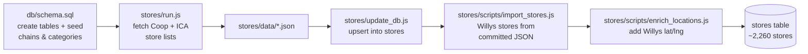
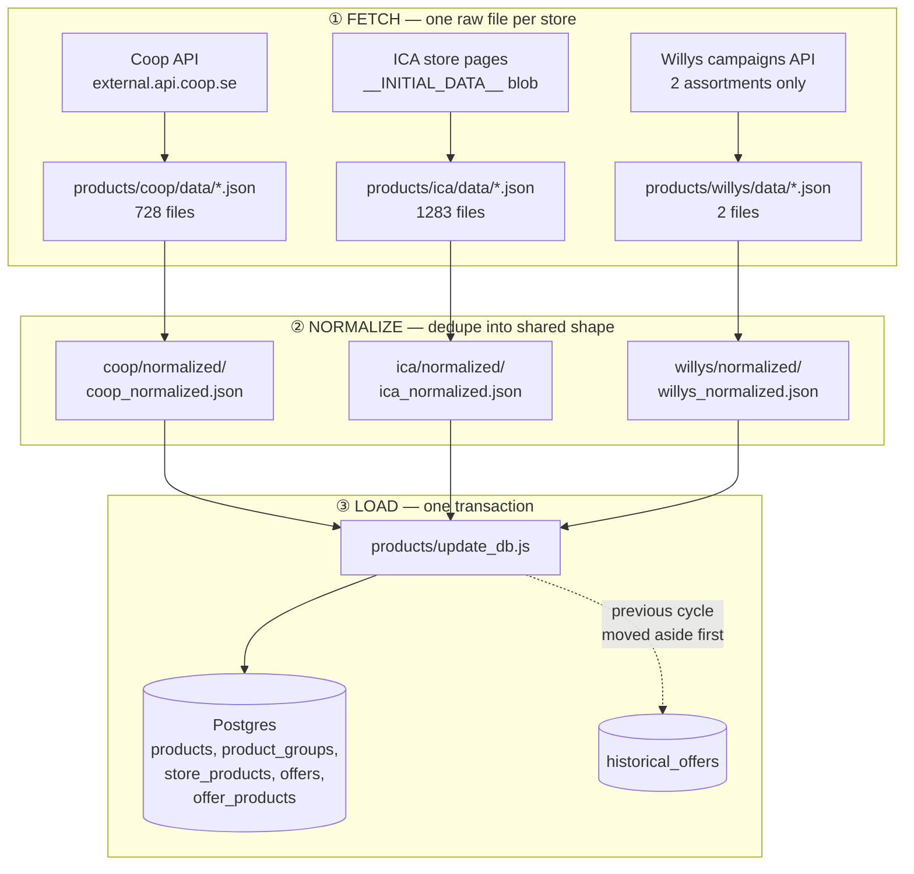
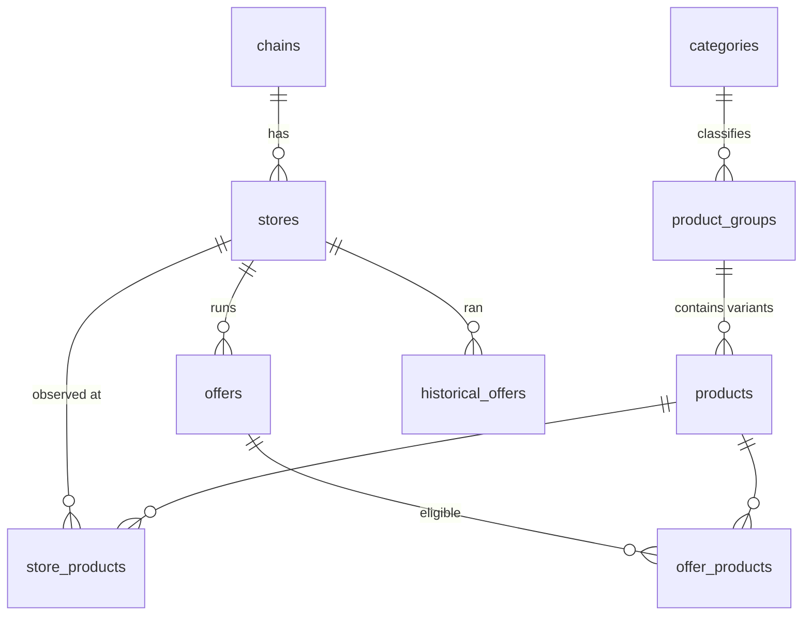

# Kassepris scraper

Collects **this week's supermarket offers** in Sweden from **Coop, ICA and Willys**,
normalizes them into one shared model, and loads them into Postgres so an app can
answer "where is this product cheapest near me?".

It is **not** a full assortment scraper — only products that are *on offer*, at the
*specific physical stores* the user cares about. No browser is involved: everything
is plain HTTP against endpoints the retailers' own websites call.

It runs as a **batch job that starts, finishes and exits** (weekly on AWS Fargate),
not as a server.

---

## The two flows

There are exactly two things this repo does. Everything else is supporting code.

### 1. Setup — `npm run db:init` (once per database)

Creates the schema and loads the *stores*. Stores rarely change, so this is not on a schedule.



### 2. Weekly job — `npm run products:update-all`

Fetches every store's current offers and reloads the offer side of the database.
This is the recurring job. Takes ~15 min, most of it waiting on ICA's rate limit.



**Why three steps and not one?** Fetching is slow and fragile (rate limits, retries,
~2000 HTTP calls); normalizing and loading are fast and pure. Keeping raw responses
on disk means you can re-run normalize/load a hundred times while debugging without
touching the retailers again.

---

## What's in each top-level folder

| Folder | In one line |
|---|---|
| [products/](products/) | The weekly job: fetch offers → normalize → load into DB. The heart of the repo. |
| [stores/](stores/) | The one-time job: discover physical stores and their addresses/coordinates. |
| [db/](db/) | Postgres connection, the schema, and the legacy→current migration. |
| [config/](config/) | Decides which `.env` file is in play (development / test / production). |
| [scripts/](scripts/) | Two bash wrappers that chain the npm scripts into the two flows above. |
| [deploy/](deploy/) | AWS Fargate task definition + step-by-step deploy runbook. |
| [docs/](docs/) | Design docs. Start with [architecture.md](docs/architecture.md). |

A **file-by-file** breakdown of all 33 source files lives in
**[docs/architecture.md](docs/architecture.md)** — read that when you need to know
what a specific file does.

---

## Quick start

```bash
cp .env.example .env          # fill in the two COOP_* keys and DB_URL
npm install

docker compose up -d db       # throwaway Postgres on port 5433
npm run db:init               # schema + all stores  (slow, one time)
npm run products:update-all   # the weekly job       (~15 min)
```

Or entirely in Docker:

```bash
make build
make test        # up Postgres → db:init → pipeline → row counts
make test-down
```

## Commands

| Command | Does |
|---|---|
| `npm run db:init` | **Setup flow** — schema + all stores, for a fresh database |
| `npm run products:update-all` | **Weekly flow** — fetch, normalize, load all three chains |
| `npm run db:schema` | Apply `db/schema.sql` only (idempotent) |
| `npm run db:migrate` | Migrate a *legacy* database into the current schema (destructive — back up first) |
| `npm run products:fetch` | Coop + ICA: fetch **and** normalize |
| `npm run products:willys:fetch` | Willys: fetch only |
| `npm run products:willys:normalize` | Willys: normalize only |
| `npm run products:update-db` | Load the three `*_normalized.json` files into Postgres |
| `npm run stores:fetch` | Coop + ICA store lists → `stores/data/` |
| `npm run stores:update-db` | Upsert Coop + ICA stores |
| `npm run stores:willys:update-db` | Upsert Willys stores from the committed JSON |
| `npm run stores:willys:enrich-locations` | Fill in Willys lat/lng |

Deployment (build, ECR push, Fargate) is all `make` — see [deploy/README.md](deploy/README.md).

---

## The data model in one picture



Key ideas:

- **`products` is keyed by GTIN** (the real barcode). One barcode = one row, shared
  across all three chains — that's what makes "cheapest price" a plain SQL join.
- **`product_groups`** is the user-facing "one search result". A mix-and-match deal
  ("3 för 59 kr" across three sausage variants) is *one group* with *several products*.
- **`offers` holds only the current week.** Last week's rows are copied into
  `historical_offers` and deleted, per chain, at the start of each load.
- **Money is integer öre**, never floats.
- **Only stores and chains are precious.** Product and offer data is disposable —
  it's re-fetchable in 15 minutes.

Full commentary is inline in [db/schema.sql](db/schema.sql).

> **Known problem:** the GTIN identity model has real flaws (padding variants split
> one product into several rows; no-GTIN products are dropped; in-store barcodes get
> falsely merged). This is being redesigned — the problem statement is in
> [docs/product-identity.md](docs/product-identity.md).

---

## Environments

`APP_ENV` selects a profile and which env file layers on top of `.env`:

| `APP_ENV` | Database | Fetch pacing |
|---|---|---|
| `development` (default) | local Postgres | fast — no politeness delay |
| `test` | throwaway Postgres from `docker-compose.yml` (port 5433) | fast |
| `production` | AWS RDS, SSL on | honors each chain's declared limits |

Politeness is **only** what each chain actually declares — no invented numbers:

- **Coop** declares nothing → no delay.
- **ICA** publishes `72 requests / 60s` in its `RateLimit-*` headers → 850 ms floor,
  and it's *enforced* (going faster gets the IP 403'd). This is why ICA dominates runtime.
- **Willys** `robots.txt` says `Crawl-delay: 10` → honored in production only.

All knobs are documented in [.env.example](.env.example).
