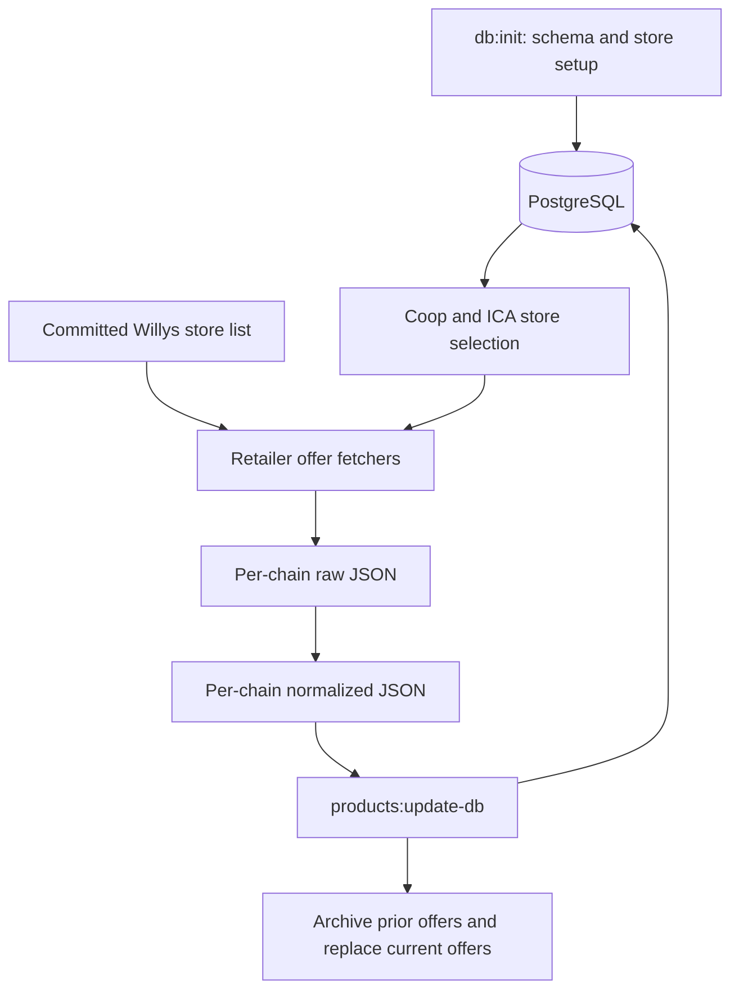

# Kassepris supermarket scraper

Batch data pipeline for **Coop, ICA, and Willys** in Sweden. It discovers stores, fetches promotional product offers, normalizes retailer data, and writes products, store observations, current offers, and offer history to PostgreSQL. Product records include retailer image URLs; this repository does not download or serve the images.

This is an offer feed, not a complete inventory of every product a store sells. It runs to completion rather than serving an HTTP API (despite the package name `supermarket-api`).

## Documentation

| Start here for… | Guide |
| --- | --- |
| Pipeline stages, retailer differences, normalized data, database behavior | [Architecture](docs/architecture.md) |
| What each source file does; where to make a change | [Repository map](docs/repository-map.md) |
| Configuration, local commands, tests, troubleshooting | [Development and operations](docs/development.md) |
| Docker image, manual AWS release, scheduling | [Deployment runbook](deploy/README.md) |
| Fast context and working rules for coding agents | [AGENTS.md](AGENTS.md) |
| Unfinished product identity requirements | [Product identity problem statement](docs/product-identity.md) |

These guides describe the working tree inspected on **2026-09-15**, including existing uncommitted identity changes. The user reports a Docker deployment on AWS; this review inspected repository files, not the live AWS configuration or database. There is no checked-in CI/CD workflow.

## Pipeline at a glance



- **Setup:** `npm run db:init` applies the schema, fetches/imports Coop and ICA stores, imports the committed Willys list, and enriches Willys locations.
- **Recurring job:** `npm run products:update-all` fetches and normalizes all three chains, then imports them in one database transaction.
- **Important naming detail:** `npm run products:fetch` handles only Coop and ICA and includes normalization. It does not import data or run Willys.

## First local run

Use Node.js 22 (the Docker image's version), npm, and Docker with Compose. Run commands from this directory. Local configuration files contain credentials and are ignored by Git.

```bash
# Only create this if you do not already have a .env file:
cp .env.example .env
# Edit .env: fill in both COOP_*_SUBSCRIPTION_KEY values.

# Install without downloading Chromium; ordinary ingestion uses HTTP.
PUPPETEER_SKIP_DOWNLOAD=true npm ci
npm run test:unit

# Build and initialize the disposable Compose database.
docker compose build app
docker compose run --rm app npm run db:init

# Full live offer refresh (see current limitations below first).
docker compose run --rm app npm run products:update-all
make test-psql
```

Compose directs the app to its PostgreSQL database regardless of `.env`'s `DB_URL`. The host can reach it on port **5433**; the container uses `db:5432`. This setup calls live retailer services. See [development](docs/development.md) for isolated sample tests and individual commands.

## Current limitations to know before running

- **Fallback identities are unfinished:** valid GTINs are normalized at every retailer boundary and again at import, but the importer still skips products without GTINs. Applying `schema.sql` does not migrate existing table definitions. See [architecture](docs/architecture.md#identity-work-in-progress).
- **A zero exit code does not prove complete retailer coverage.** Fetchers can log failures and continue, and old raw files can remain on disk. Review per-chain fetch and import summaries before trusting a refresh.
- **Importing a present normalized file replaces that whole chain's current offers.** An empty file can clear them; a missing file leaves that chain untouched. Re-importing also adds another historical snapshot.

The documentation work left application code and pre-existing edits unchanged. Verification: **11 unit tests passed**; no live scrape, database reset, migration, or AWS operation was performed.
