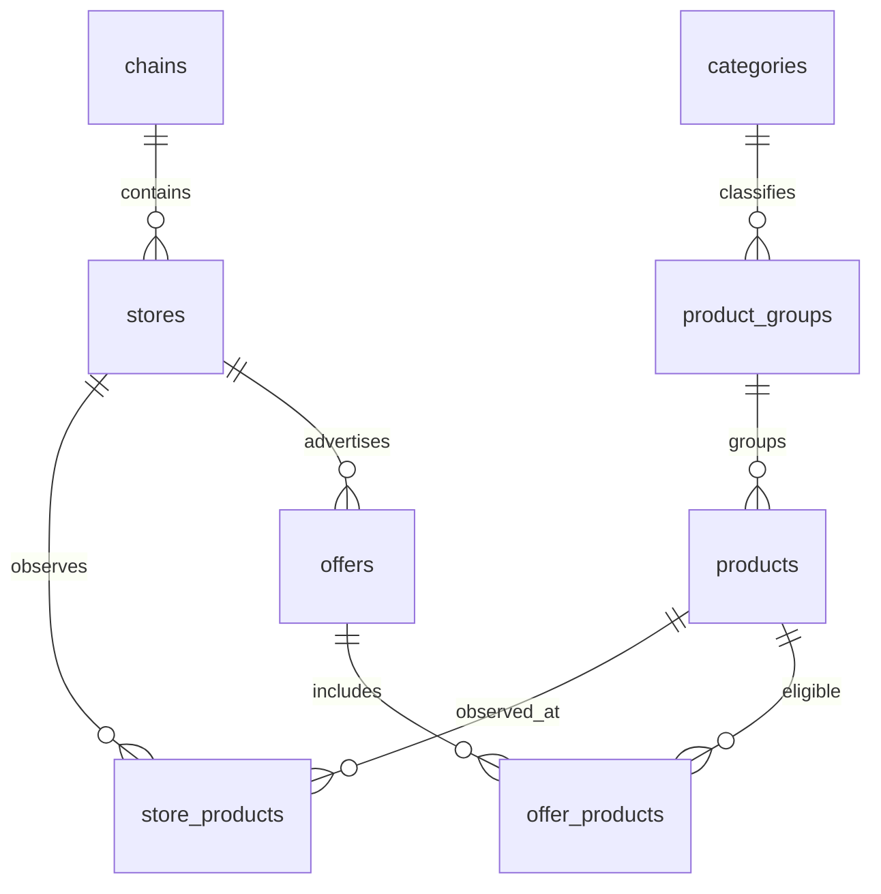

# Pipeline architecture and data model

[Documentation home](../README.md) · [File map](repository-map.md) · [Operations](development.md)

This describes source behavior inspected on 2026-09-15. Retailer endpoints and response shapes below are those used by the code; they were not revalidated against live services during documentation.

## 1. Store setup

`scripts/init-db.sh` applies `db/schema.sql`, then populates physical stores:

| Chain | Discovery | Database matching key |
| --- | --- | --- |
| Coop | Bulk API list plus detail requests for location data | `external_id` is the store URL path, typically `coop/<slug>/`; not the API ledger number |
| ICA | Store locator HTML; embedded `window.__INITIAL_DATA__` | `external_id` is `accountNumber`; offer import matches the suffix of the stored offers-page URL |
| Willys | Committed `stores/willys/willys_stores.json`; separate CMS location enrichment | Store code identifies a location; offer assortment is inferred from whether the store name contains `Hemma` |

Coop/ICA discovery writes `stores/data/{coop,ica}_stores.json`; `stores/update_db.js` upserts those records. Store imports preserve UUIDs and do not delete locations absent from the latest input. They are not one atomic transaction across all stores. Willys enrichment only selects rows with null latitude, so it does not periodically refresh existing coordinates.

The optional `stores/willys/willys_stores.js` browser script is a legacy discovery aid. It needs an absent `willys_store_codes.json` relative to its working directory and writes `willys_stores_with_names.json`, not the canonical importer input. It is not part of normal initialization.

## 2. Offer fetching

`scripts/update-products.sh` runs each stage sequentially with shell error handling. Its first command, `products:fetch`, itself runs Coop fetch → Coop normalize → ICA fetch → ICA normalize.

| Chain | Input and upstream source | Output and special handling |
| --- | --- | --- |
| Coop | Stores from PostgreSQL; `proxy.api.coop.se` store list maps paths to ledger IDs; `external.api.coop.se/dke/offers/sorting-groups/<ledger>` | Per-store JSON. Uses the `alla` sorting group. Clustered items become products sharing `variantGroup`. Both Coop subscription keys are required. |
| ICA | Stores/offer URLs from PostgreSQL; fetches HTML from ICA offers pages | Per-store JSON. Extracts the balanced object assigned to `window.__INITIAL_DATA__`, combines offer arrays, deduplicates offer IDs, and expands multiple EANs into variants. |
| Willys | First representative regular/Hemma stores in committed JSON; `/axfood/rest/v1/search/campaigns/offline` | `willys.json` and `willys-hemma.json`. Discovers category facets and paginates campaigns; Axfood image GTINs are canonicalized, catalog lookups recover missing GTINs by exact retailer product code, and verified real mix-and-match campaigns expand to their eligible GTIN-bearing SKUs. |

Willys assumes two shared newspaper assortments, not one individually fetched offer feed per physical store. Its importer later fans each assortment out across matching stores in PostgreSQL. Seeding fewer DB stores does not reduce Willys's upstream fetch in the same way it reduces Coop/ICA requests.

### Reliability components

- `httpClient.js`: native fetch, timeout, retries/backoff/jitter, shared request-start pacing, and response rate-limit handling. Retry statuses include 408, 429, 500, 502, 503, and 504; network errors also retry.
- `concurrency.js`: bounded workers and additional whole-store retry passes for Coop/ICA.
- `checkpoint.js`: records completed stores/assortments after output is written. Interrupted runs can resume if the files survive. Normal completion clears checkpoints, including when some work items failed.
- `httpCache.js`: Coop's disk response cache; honors `Cache-Control: max-age`, defaults to 15 minutes, and can send conditional request headers when available. ICA/Willys do not configure this cache.
- `schemaCheck.js`: samples response paths/types and warns about shape changes. It updates its baseline automatically; it is not validation that blocks bad input.
- `logger.js` / `metrics.js`: readable timestamped logs and run summaries with request counts, failures, timings, payload/cache/schema information. Output is not a pure JSON-lines event stream.

**Completeness is not fully enforced:** Coop/ICA failure counts are not turned into orchestration errors. Raw directories are not cleared, so a failed fetch can leave an older store/assortment file available for normalization. Checkpoints are crash recovery, not a guarantee of a complete or fresh snapshot.

Willys additionally requires every emitted raw product row to have a verified GTIN. Its catalog recovery expands missing-GTIN mix-and-match cards into eligible GTIN-bearing SKUs; if any row remains unresolved, that assortment fails before its output file is written.

## 3. Normalization contract

Each normalizer reads its chain's raw directory and writes one JSON array to:

```text
products/<chain>/normalized/<chain>_normalized.json
```

`PIPELINE_DATA_ROOT=/some/path` changes this to `/some/path/<chain>/normalized/...` and likewise relocates raw `data` and `.state` directories. It does not relocate store discovery output or the committed Willys input.

| Product field | Meaning |
| --- | --- |
| `gtin` | Barcode identity when available; canonicalization is currently incomplete across chains |
| `fingerprint` | Fallback string derived from attributes; used for in-memory normalizer deduplication, not currently imported into products |
| `variantGroup` | Retailer campaign identifier; importer scopes it by chain and uses it only within the run |
| `title`, `brand`, `size`, `moreInfo` | Display metadata |
| `image` | Remote retailer image URL; stored as `products.image_url` |
| `badges` | Normalized retailer traits/labels; not persisted by the current importer |
| `categorySlug`, `categoryName`, `rawCategoryName` | Shared category and source category; category slug resolves the DB group category |
| `storeOffers` | Array of store/assortment-specific deals |

| Offer field | Meaning |
| --- | --- |
| `store` | Coop path, ICA offer URL suffix, or Willys assortment |
| `priceCents` | Advertised transaction price in integer öre; `3 för 25` is `2500`, not a per-item price |
| `savingsCents` | Savings for that same transaction/bundle, when known |
| `deal`, `dealQuantity`, `unit` | Deal description, bundle quantity, and sale unit |
| `comparisonPrice` | Source comparison text |
| `comparisonPriceMinCents`, `comparisonPriceMaxCents`, `comparisonUnit` | Comparable price bounds and their unit |
| `isMember` | Whether the deal requires membership |
| `validFrom`, `validUntil` | Retailer validity values, later clamped/validated during import |

Comparison parsing preserves ranges and unit magnitudes: `hg` is not converted to `kg`. Supported normalized units include `kg`, `hg`, `g`, `l`, `st`, and `m`. A multi-buy without a usable comparison price may derive an `st` price from bundle total/quantity. Unknown qualified units can result in null comparison values.

Normalizers deduplicate by `gtin || fingerprint`; first product metadata wins and only one offer per store key is retained. This can discard another deal for the same product/store. Per-product normalization errors are counted and skipped; malformed JSON fails the file read. Unknown retailer category mappings can cause skipped products. Shared categories are in `products/categories/displayCategories.js`, with matching SQL seeds; retailer mappings remain in each normalizer.

`fingerprint.js` builds a string from values after uppercasing/removing whitespace and substituting `NULL` for missing values. It is not a cryptographic hash, and input value order matters.

## 4. PostgreSQL model

Fresh schema requires PostgreSQL, including `pgcrypto` and `pg_trgm`. Compose supplies PostgreSQL 17. UUIDs identify entities; a trigram index supports product-title search.



| Table | Lifetime and purpose |
| --- | --- |
| `chains` | Seeded Coop, ICA, Willys; slug selects importer logic |
| `stores` | Physical locations; unique `(chain_id, external_id)` |
| `categories` | Eleven seeded display categories |
| `product_groups` | Persistent search/display grouping with a category |
| `products` | Persistent product identity and display fields, linked to one group |
| `store_products` | Persistent observations with first/last seen timestamps; not inventory or stock availability |
| `offers` | Latest imported deal rows, replaced by chain |
| `offer_products` | Eligible products, allowing mix-and-match deals |

### Import transaction and replacement semantics

`products/update_db.js` opens **one transaction for all available chain files**:

1. Load chain/category/store lookups and normalized JSON.
2. Delete every current offer and its eligibility links for that chain; prior offers are discarded.
3. Resolve GTIN products, retaining existing UUIDs/groups; create new products/groups when needed.
4. Upsert store observations for matched offers with price/end date.
5. Group variant deals, aggregate comparison ranges, and insert offers plus product links.
6. Commit all chains; a parsing/SQL exception rolls the transaction back.

Missing files leave a chain untouched. A present empty array clears its current offers. There is no timestamp/freshness gate, cycle identifier, importer chain selector, or overlapping-run lock. Running the importer twice replaces current offers again; it does not retain a prior-offer history.

Unknown categories, missing GTINs, unmatched stores, or absent price/end date can skip data without aborting import. Existing product titles/categories/groups are retained; brand/size/image fill only missing values, and the run-wide GTIN cache can bypass even those updates on later chain encounters. Grouping a new campaign does not merge already-existing product groups.

Campaign offer grouping uses store, chain-scoped campaign, price, text, end date, membership, quantity, and unit. Standalone grouping uses store/product. Comparison bounds widen across variant products. `original_price_cents` is price plus savings when both exist. Start dates are clamped to ingestion time when absent/future and then to the end date if needed. Expired input can still be imported: “current” means the latest loaded dataset, not necessarily valid at this instant.

The integration suite checks one current offer per product/store, but there is no database constraint enforcing that cross-table rule in all circumstances.

## Identity work in progress

The working tree has partial changes toward the requirements in [product-identity.md](product-identity.md). That historical document's statistics and branch references are context, not measurements or deployment facts verified in this review.

| Area | Current implementation gap |
| --- | --- |
| Canonical GTIN helper | `gtin.js` exports checksum, normalization, restricted classification; Coop external IDs, ICA EAN IDs, and Willys Axfood image IDs all normalize before import |
| Willys fetch | Extracts the 14-digit Axfood image filename and passes it to the shared normalizer. Missing card GTINs use catalog recovery: exact product code for ordinary products, or exact promotion-code expansion for mix-and-match campaigns. |
| Fallback identity | Deliberately out of scope: the strict schema/importer skip products without a verified GTIN |
| Restricted codes | The helper identifies restricted-circulation codes, but the current simple model stores a canonical GTIN as the only product identity and has no comparability metadata |
| Exactly one identity | Fresh-schema `products.gtin` is `NOT NULL UNIQUE`; existing databases still need a dedicated migration if they differ |
| Restricted identity scope | GTIN uniqueness remains global, with no chain/store scope for restricted codes |
| Existing database upgrade | No canonicalization/merge/backfill migration is present |

`db:schema` creates missing objects but does not alter existing table definitions to match changed DDL. There is no generic migration command: a production schema change needs a dedicated, reviewed, tested migration.
