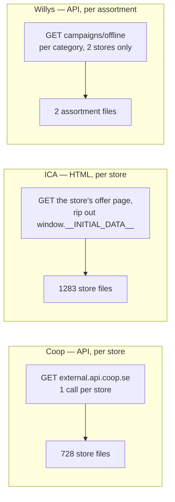
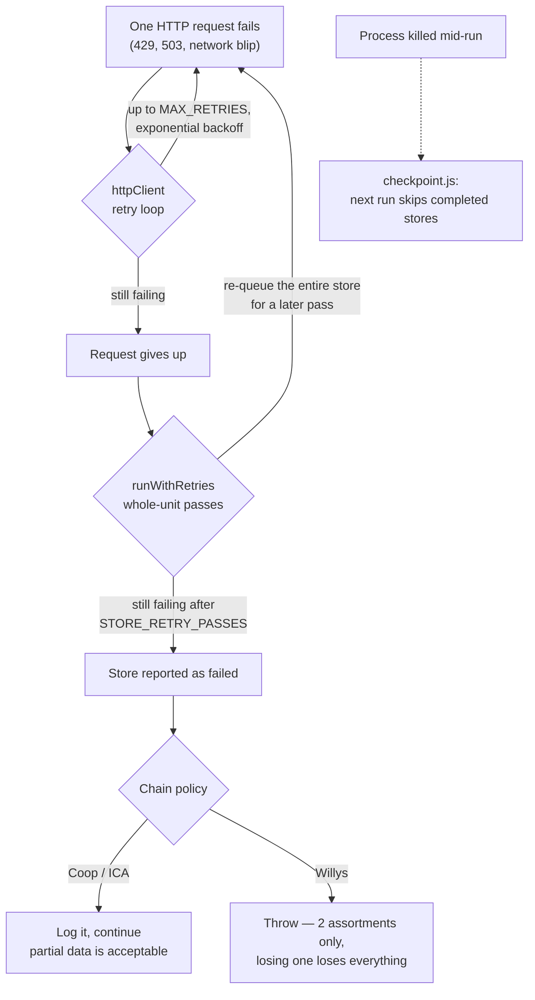

# Architecture — every folder and file, in plain terms

Companion to the [README](../README.md). The README says *what the app does*;
this says *what each file is for*. ~3,500 lines of JS across 33 source files.

---

## Contents

- [The shape of the repo](#the-shape-of-the-repo)
- [How one weekly run actually flows](#how-one-weekly-run-actually-flows)
- [`products/` — the weekly job](#products--the-weekly-job)
  - [`products/lib/` — shared fetch infrastructure](#productslib--shared-fetch-infrastructure)
  - [`products/categories/` — retailer vocab → our vocab](#productscategories--retailer-vocab--our-vocab)
  - [Per-chain: coop, ica, willys](#per-chain-coop-ica-willys)
- [`stores/` — the one-time job](#stores--the-one-time-job)
- [`db/` — schema and connection](#db--schema-and-connection)
- [`config/`, `scripts/`, `deploy/`, `docs/`](#config-scripts-deploy-docs)
- [Root files](#root-files)
- [Generated / ignored directories](#generated--ignored-directories)
- [Cross-cutting: the three-layer retry story](#cross-cutting-the-three-layer-retry-story)

---

## The shape of the repo

```
supermarket-scraper/
├── products/          ← THE WEEKLY JOB: offers → normalized → DB
│   ├── lib/           ← shared fetch infrastructure (retry, cache, metrics…)
│   ├── categories/    ← retailer category & badge → our taxonomy
│   ├── coop/ ica/ willys/   ← one folder per chain: fetch.js + normalize.js
│   ├── run.js         ← runs Coop + ICA fetch+normalize
│   └── update_db.js   ← loads all three normalized files into Postgres
├── stores/            ← THE ONE-TIME JOB: discover physical stores
│   ├── coop/ ica/ willys/
│   ├── scripts/       ← Willys-specific import + geo enrichment
│   ├── run.js
│   └── update_db.js
├── db/                ← pool, schema.sql, migration.sql + their runners
├── config/            ← env.js: which .env is in play
├── scripts/           ← the two bash flows
├── deploy/            ← Fargate task def + runbook
└── docs/              ← you are here
```

The symmetry is deliberate: `products/` and `stores/` have the **same shape**
(`<chain>/fetch.js` → `run.js` → `update_db.js`). Learn one, you know the other.

---

## How one weekly run actually flows

```mermaid
sequenceDiagram
    participant S as scripts/update-products.sh
    participant F as products/&lt;chain&gt;/fetch.js
    participant L as products/lib/*
    participant N as products/&lt;chain&gt;/normalize.js
    participant U as products/update_db.js
    participant PG as Postgres

    S->>F: 1. fetch
    F->>PG: read store list (Coop/ICA)
    loop per store / per assortment-category
        F->>L: httpClient.fetchJson(url)
        L->>L: cache hit? → skip network
        L->>L: rate gate + retry + backoff
        L-->>F: parsed JSON
        F->>L: checkpoint.markDone(store)
        F->>L: schemaCheck — did the API shape drift?
    end
    F->>F: write data/&lt;store&gt;.json (raw, reshaped field names)
    L-->>S: metrics report (requests, cache hits, retries, failures, p50 ms)

    S->>N: 2. normalize
    N->>N: map retailer category → our slug (unknown ⇒ throw)
    N->>N: dedupe by gtin, else by fingerprint
    N->>N: write normalized/&lt;chain&gt;_normalized.json

    S->>U: 3. load
    U->>PG: BEGIN
    loop per chain
        U->>PG: copy current offers → historical_offers, then DELETE
        U->>PG: upsert products (by gtin) + product_groups
        U->>PG: upsert store_products (first_seen / last_seen)
        U->>PG: insert offers + offer_products
    end
    U->>PG: COMMIT (any error ⇒ ROLLBACK, DB untouched)
```

---

## `products/` — the weekly job

| File | What it is |
|---|---|
| [products/run.js](../products/run.js) | 4 lines of orchestration: fetch Coop → normalize Coop → fetch ICA → normalize ICA. Willys is *not* here (it has its own npm scripts because its fetch is shaped differently). |
| [products/update_db.js](../products/update_db.js) | **Step 3.** Reads the three `*_normalized.json` files and writes the whole current-offer side of the DB in **one transaction**. Also does the archive-then-replace of last cycle's offers, scoped per chain — so a chain whose file is missing this run is left completely untouched. 353 lines, the single densest file in the repo. |

### `products/lib/` — shared fetch infrastructure

This folder is why each `fetch.js` only has to say *what* to fetch. Everything about
fetching *safely* lives here.

| File | What it is |
|---|---|
| [httpClient.js](../products/lib/httpClient.js) | The workhorse (206 lines). One resilient fetch wrapper: retries with exponential backoff on 408/429/5xx, an adaptive **rate gate** that spaces out request *starts* independently of concurrency, reads `RateLimit-*` headers when a server publishes them (ICA does), backs off fast on failure and recovers slowly on success, and wires in the cache, logger and metrics. |
| [httpCache.js](../products/lib/httpCache.js) | File-based response cache keyed by URL hash. Honors the server's own `Cache-Control: max-age` (Coop's offers say 900s). Sends `If-None-Match`/`If-Modified-Since` when an entry has them — currently no chain supports it, but it'll work automatically if one starts. |
| [concurrency.js](../products/lib/concurrency.js) | Two worker pools. `runWithConcurrency` bounds how many fetches run at once; `runWithRetries` adds **whole-unit retry passes** — a store that failed even after the per-request retries gets another shot in a later pass. |
| [checkpoint.js](../products/lib/checkpoint.js) | Crash recovery. Records each completed store id to disk **after every item**, so a killed run resumes instead of restarting. Cleared on a fully successful run — it's per-run resume, not a cross-run cache. |
| [schemaCheck.js](../products/lib/schemaCheck.js) | Silent-failure detector. Reduces a sample response to sorted `path:type` pairs and diffs against a stored baseline, so Coop renaming `priceInformation.discountValue` shows up as a loud warning instead of a column quietly filling with nulls. |
| [metrics.js](../products/lib/metrics.js) | Accumulates counters across a run — requests, cache hits, retries, failures, response times, payload sizes, schema changes — and prints the end-of-run report. |
| [logger.js](../products/lib/logger.js) | Minimal scoped logger. One human line + JSON fields, level-filtered by `LOG_LEVEL`. |
| [priceParsing.js](../products/lib/priceParsing.js) | Turns Swedish human price text (`"79,90 kr"`, `"48,17-52,90"`) into integer öre. Ranges report their lower bound. |
| [comparisonPrice.js](../products/lib/comparisonPrice.js) | Parses "jämförpris" (per-unit price) — much messier than the sticker price. Coop writes `73,20`, ICA/Willys write `16:66`; units carry qualifiers like `/kgutanspad` (per kg *drained*) that look comparable but aren't. Only a small set of unambiguous units is accepted; everything else returns `null` rather than guess. ~half of all comparison strings are genuine **ranges**, so it returns `{minCents, maxCents, unit}`. |
| [gtin.js](../products/lib/gtin.js) | GS1 check-digit validation for 13-digit barcodes. Its real job is filtering numbers *recovered from places that aren't a barcode field* — see Willys' image-URL trick below. |
| [fingerprint.js](../products/lib/fingerprint.js) | Fallback identity for offers with no barcode: joins an already-chosen set of fields (title/brand/size) into one stable uppercase key, so they can still be deduped. |
| [config.js](../products/lib/config.js) | `requireEnv` (fail loudly at startup on a missing API key) and `getEnvInt` (validated tuning knobs), plus the shared User-Agent. |

### `products/categories/` — retailer vocab → our vocab

| File | What it is |
|---|---|
| [displayCategories.js](../products/categories/displayCategories.js) | The 11 Kassepris categories (`fresh_food`, `dairy_and_eggs`, …). Must stay in sync with the seed block at the bottom of `db/schema.sql`. |
| [badges.js](../products/categories/badges.js) | Maps each chain's raw label codes (`krav`, `keyhole`, `glutenfree`…) into one `{slug, label, type, icon}` shape, so the app renders a badge without per-chain logic. Coop currently has no badge data at all. |

Each chain's own category map lives at the top of its `normalize.js`. An **unmapped
category throws** — a new retailer category is a thing to decide about, not to
silently bucket into "other".

### Per-chain: coop, ica, willys

All three write the *same* shape, but get there very differently:



| File | What it is |
|---|---|
| [coop/fetch.js](../products/coop/fetch.js) | Reads Coop stores from the DB, calls Coop's own offers JSON API once per store (the same endpoint their website calls), writes `data/<store>.json`. Needs two public subscription keys from Coop's frontend bundle — public, not secrets, but kept in `.env` for hygiene. Coop declares no rate limit, so concurrency 10. |
| [coop/normalize.js](../products/coop/normalize.js) | Collapses all 728 files into one product list, deduped by gtin (else fingerprint), each with a `storeOffers[]` array. Price/deal/validity stay **per store**. |
| [ica/fetch.js](../products/ica/fetch.js) | ICA has no API — but it server-renders every offer into a `window.__INITIAL_DATA__` blob, so one plain GET per store gets everything. **The slow chain:** ICA publishes `72 requests / 60s` and 403-blocks you for exceeding it, so concurrency is 3 with an 850 ms floor → ~13–26 min. No response cache: ICA sends `Cache-Control: no-store`. |
| [ica/normalize.js](../products/ica/normalize.js) | Same collapse as Coop, plus badge mapping. Per-store prices matter more here — ICA stores are independently owned and ~37% of products have more than one distinct price across stores. |
| [willys/fetch.js](../products/willys/fetch.js) | The most involved fetcher (441 lines). Willys groups *every* store into one of **two shared newspaper assortments** (`willys`, `willys-hemma`), verified identical across stores — so it fetches 2 stores, not 252. Fetches **per category** because the bare response carries no category per product. Recovers GTINs by **parsing them out of image URLs** (validated by check digit), with a second pass against the regular catalog search for the handful of products whose promo image has none. Honors `robots.txt Crawl-delay: 10` in production. |
| [willys/normalize.js](../products/willys/normalize.js) | Same output shape from the two assortment files. The fan-out from "assortment" to "every physical Willys store" happens later, in `update_db.js`. |

---

## `stores/` — the one-time job

Physical store metadata: name, address, city, lat/lng, retailer URL. **This is the
data that isn't disposable** — the offers can be re-fetched in 15 minutes, the geo
enrichment can't.

| File | What it is |
|---|---|
| [stores/run.js](../stores/run.js) | Fetch Coop stores, then ICA stores. Two lines. |
| [stores/update_db.js](../stores/update_db.js) | Upserts `stores/data/{coop,ica}_stores.json` on `(chain_id, external_id)`. A plain upsert, never a truncate-and-reload — offers and `store_products` have foreign keys into `stores`, and store identity must stay stable across runs. |
| [stores/coop/fetch.js](../stores/coop/fetch.js) | One bulk call lists every Coop store; a second call per store gets its address and coordinates. The detail endpoint throttles hard, hence concurrency 3. |
| [stores/ica/fetch.js](../stores/ica/fetch.js) | Same `__INITIAL_DATA__` trick as the offer pages — one single GET of the store-locator page yields every ICA store in the country with coordinates. |
| [stores/willys/willys_stores.js](../stores/willys/willys_stores.js) | **The only Puppeteer code in the repo, and it's not in either flow.** A one-off discovery script that visited each Willys store page to read its name. Its output is committed as `willys_stores.json`, which is what actually gets imported. This is why the Docker image skips Chromium. |
| [stores/willys/willys_stores.json](../stores/willys/willys_stores.json) | The committed Willys store list — code, name, URL. |
| [stores/willys/willys_sitemap.xml](../stores/willys/willys_sitemap.xml) | Raw sitemap the store codes were originally harvested from. Reference material. |
| [stores/scripts/import_stores.js](../stores/scripts/import_stores.js) | Upserts that committed Willys JSON into `stores`. Separate from `update_db.js` because Willys has no live store API. |
| [stores/scripts/enrich_locations.js](../stores/scripts/enrich_locations.js) | Willys-only. Calls Willys' store-info CMS component per store code to fill in address/city/lat/lng — the only thing that populates Willys coordinates. Coop/ICA get theirs during their own fetch. |

---

## `db/` — schema and connection

| File | What it is |
|---|---|
| [db/schema.sql](../db/schema.sql) | **The canonical schema, and the best domain document in the repo** — heavily commented with *why* each table is shaped that way. Idempotent (`CREATE … IF NOT EXISTS`), seeds the 3 chains and 11 categories. |
| [db/pool.js](../db/pool.js) | The single shared `pg` connection pool. SSL on for RDS in production. |
| [db/apply-schema.js](../db/apply-schema.js) | Runs `schema.sql`. Node-native so no `psql` binary is needed — that's what lets `db:init` run inside the slim container. |
| [db/migration.sql](../db/migration.sql) | The **destructive half** of the legacy→current migration: renames/reshapes `chain`→`chains`, drops the old product/price tables. Contains no `BEGIN`/`COMMIT` and creates nothing. |
| [db/migrate.js](../db/migrate.js) | Runs `migration.sql` **then** `schema.sql` in a **single transaction**, so the redesign is atomic — either fully migrated or entirely unchanged. Prints row counts after. Only stores and chains survive; product data is re-fetched. **Back up first.** |

### The tables

| Table | Lifetime | Holds |
|---|---|---|
| `chains` | permanent | Coop, ICA, Willys |
| `stores` | permanent | one physical shop; `(chain_id, external_id)` unique |
| `categories` | permanent | our 11 normalized categories |
| `product_groups` | persistent | the user-facing "one search result"; carries the category |
| `products` | persistent | one SKU, keyed globally by GTIN, shared across chains |
| `store_products` | persistent | "we've observed this product at this store" + first/last seen |
| `offers` | **current week only** | one deal at one store; integer öre; comparison-price min/max |
| `offer_products` | current week only | which SKUs a mix-and-match deal covers |
| `historical_offers` | archive | last cycles' offers, copied verbatim before deletion |
| `historical_offer_products` | archive | frozen eligibility of a past offer |

---

## `config/`, `scripts/`, `deploy/`, `docs/`

| File | What it is |
|---|---|
| [config/env.js](../config/env.js) | The one place that decides which environment is active. `APP_ENV` picks a profile; `.env.<APP_ENV>` loads first and wins, then `.env` fills in shared values. Every entrypoint imports it (often indirectly) for the load side-effect, so scripts just read `process.env`. |
| [scripts/init-db.sh](../scripts/init-db.sh) | The 5-step setup flow (schema → Coop/ICA stores → upsert → Willys import → Willys geo). Backs `npm run db:init`. |
| [scripts/update-products.sh](../scripts/update-products.sh) | The 4-step weekly flow (Coop+ICA → Willys fetch → Willys normalize → load). Backs `npm run products:update-all`. Never touches `stores`. |
| [deploy/README.md](../deploy/README.md) | Full runbook: build → local test → ECR → IAM roles → Secrets Manager → register task → first manual run → EventBridge weekly schedule. |
| [deploy/ecs-task-definition.json](../deploy/ecs-task-definition.json) | The Fargate task definition (placeholders for account id and region). |
| [docs/product-identity.md](product-identity.md) | Problem statement for the **GTIN identity redesign** — the known-broken part of the model, with evidence and validated building blocks. Read before touching anything gtin-related. |
| [docs/architecture.md](architecture.md) | This file. |

---

## Root files

| File | What it is |
|---|---|
| [package.json](../package.json) | 3 dependencies: `pg`, `dotenv`, `puppeteer` (the last only for the out-of-band Willys store discovery). ESM (`"type": "module"`), top-level `await` used freely. |
| [Dockerfile](../Dockerfile) | `node:22-slim`, `tini` as PID 1 for clean SIGTERM on Fargate, Chromium download skipped, runs as the unprivileged `node` user. Default command is the weekly job. |
| [docker-compose.yml](../docker-compose.yml) | Throwaway Postgres 17 on **port 5433** (so it never collides with a local 5432) plus the app for one-off `docker compose run` commands. Tests need real Postgres — the schema uses `gen_random_uuid`, `pg_trgm`, `xpath`, so SQLite is not an option. |
| [Makefile](../Makefile) | `build` / `test` / `test-down` / `push` / `register-task` / `run-task`. All AWS settings are overridable variables. |
| [.env.example](../.env.example) | Every knob, documented — including exactly which rate limit each chain declares and why. |
| [.dockerignore](../.dockerignore), [.gitignore](../.gitignore) | Keep scraped data, `.state/`, and env files out of the image and out of git. |

---

## Generated / ignored directories

These exist on disk but are **not** in git — they're rebuilt by a run:

| Path | Contents |
|---|---|
| `products/<chain>/data/` | Raw per-store responses. 728 Coop + 1283 ICA + 2 Willys files. |
| `products/<chain>/normalized/` | The one deduped JSON per chain that `update_db.js` reads. |
| `products/<chain>/.state/cache/` | HTTP response cache (Coop only, in practice). |
| `products/<chain>/.state/schema-baseline-*.json` | Last-known API response shape, for drift detection. |
| `products/<chain>/.state/checkpoint*` | Resume state for an interrupted run. |
| `stores/data/` | `coop_stores.json`, `ica_stores.json`. |
| `products/lib/imageSources/exports/` | Open Food/Beauty/Products Facts dumps (`*.jsonl.gz`), staged for the separate product-images work. Not wired into any flow yet. |

---

## Cross-cutting: the three-layer retry story

Worth understanding, because it's spread across three files by design:



Three separate concerns, deliberately not merged: **within-a-request** flakiness
(`httpClient`), **a whole unit of work** that still failed (`concurrency.js`), and
**the process dying** (`checkpoint.js`).
